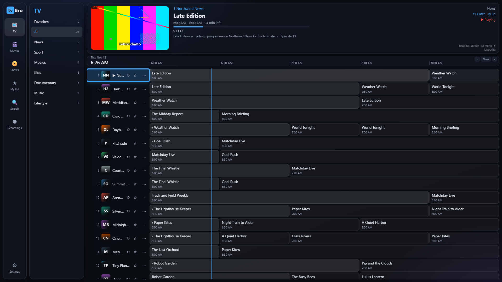
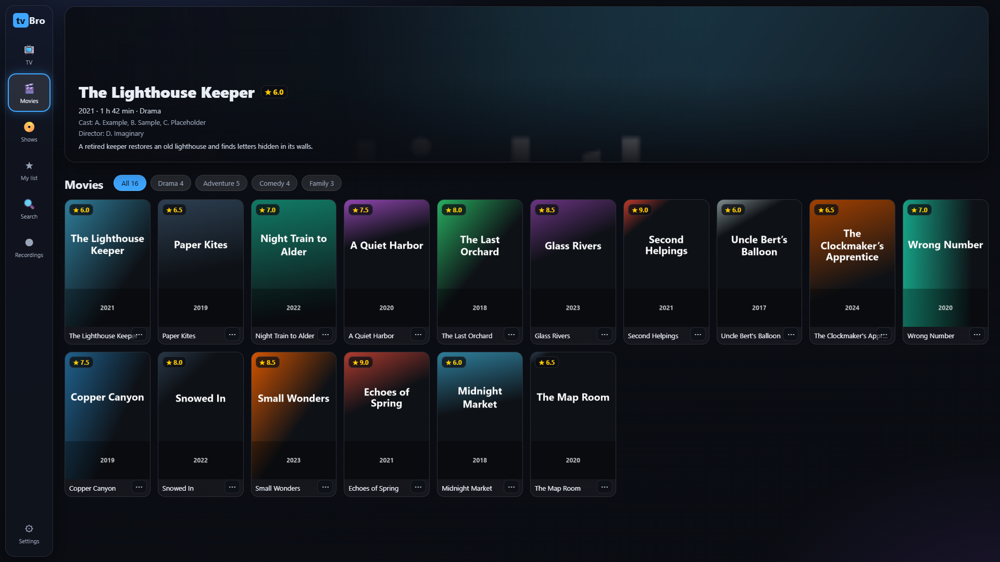
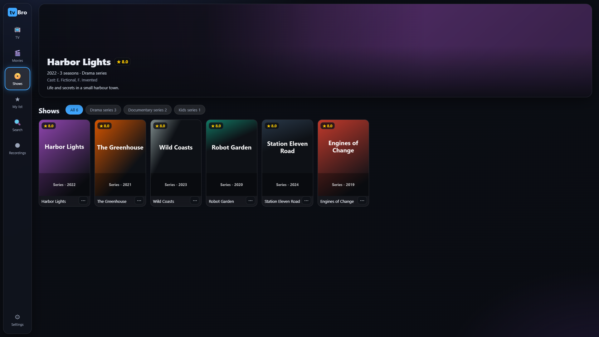
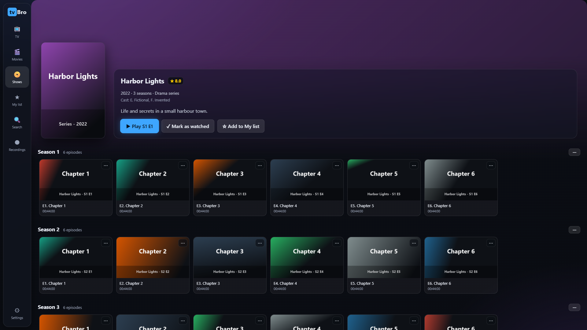
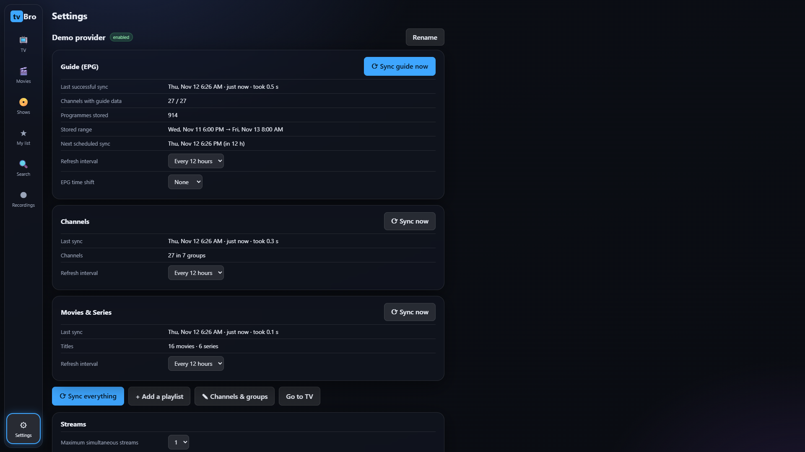
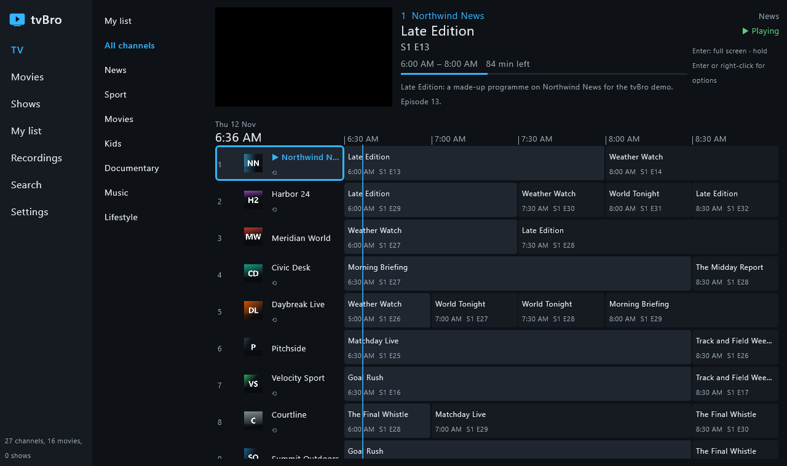

# tvBro

**A free, open-source IPTV player for Android TV, Fire TV, phones, Windows, Raspberry Pi and your own home server.**

tvBro plays the live TV, guide, films and series of an IPTV service you already have. Add your
Xtream Codes login or an M3U playlist (with an XMLTV guide) and get a fast, remote-friendly TV app:
a live guide with catch-up, search across everything, recordings, reminders and resume where you
left off. Dark theme, big focus outlines, built for the remote.

> tvBro is a **player only**. It ships no channels, streams, playlists or other content and is not
> affiliated with any provider. You add your own sources and must have the rights to watch them.

[Download the latest Android APK](https://github.com/kmmarin/tvBro/releases/latest) ·
[How to install](docs/INSTALL.md) · [All releases](https://github.com/kmmarin/tvBro/releases) ·
[Report a bug](https://github.com/kmmarin/tvBro/issues/new/choose)

## Screenshots



| | |
|---|---|
|  |  |
|  |  |
|  | |

Most screenshots show the self-hosted web app at 1920x1080; the Android TV and desktop apps use the
same TV layout (Android TV screenshots will follow). All of them use the made-up demo provider in `tools/demo/` (fictional channels,
programmes, films and generated artwork), never real content.

## Features

### Sources
- **Xtream Codes** login (live, films, series, catch-up) and **M3U / M3U8** playlists with one or more
  **XMLTV** guide URLs (gzip supported).
- Several playlists at once: enable, disable, reorder, remove.
- **Add a source from your phone**: the TV shows a QR code and a one-time code; a small page on your
  phone (same Wi-Fi, only while that screen is open) sends the login to the TV. No typing on the remote.
- Logins are stored encrypted on the device and never logged or shown in backups.
- Background sync per kind (channels, guide, films and series) with its own schedule; a failed or
  empty sync keeps the data you have and retries. Settings > Sync shows progress, counts and errors.
- Starts instantly from stored data, then refreshes.

### Live TV and guide
- TV screen: live preview on top, guide grid below, everything on one time scale. The guide opens at
  the current half hour; move left into the past for catch-up.
- Full-screen guide, programme details, episode code and sub-title ("S2 E4 ...").
- Groups in provider order, favourites, your own groups, rename / hide / reorder channels and groups.
- Number zapping, channel up / down, last channel on start, picture-in-picture (Android).
- Back from full screen shrinks the video into the preview without re-buffering.
- Automatic reconnect, then fallback to an alternate copy of the same channel.
- Manual channel-to-guide mapping and guide time shift for mismatched guides.
- **Catch-up**: Xtream timeshift and M3U `catchup` attributes.

### Films and series
- Poster grids with categories, details (plot, year, rating, cast, trailer), seasons and episodes.
- **Continue watching**, resume per film and per episode, watched marks for episode / season / show.
- **Up next**: plays the next episode with a countdown (can be turned off).
- Audio and subtitle language remembered per series.
- Large catalogues are stored on the device and paged, so browsing stays fast.

### Search
- One search over channels, programmes, films and shows, with results as rows.
- Fast full-text index: prefix matching per word, accents ignored ("pokemon" finds "Pokémon").
- Programme results marked as catch-up, on now (with time left) or upcoming, with Watch, Record,
  Remind and My list actions. Search history and voice search (Android).

### Recording and reminders
- Record now (until stopped, 30 min, 1 h, 2 h or the end of the programme) or schedule from the guide
  with padding; **record a series** (every airing of a title on a channel).
- Storage: internal, USB / SD card, or a **network share (SMB)** with free-space check and a Test button.
- Recordings list with play and delete.
- **Reminders**: a pop-up "starting now" with Watch now, or a notification when tvBro is in the background.

### Player
- Audio and subtitle tracks, caption size and background, video quality.
- Aspect (normal, fill, zoom, 16:9, 4:3), audio delay, sleep timer, clock, stream info.
- HEVC and MKV / AVI where the device can decode them; frame-rate matching on Android TV.
- Optional external player.

### My list, organisation and safety
- **My list**: rows of cards for continue watching, favourite channels, films, shows, programmes and recordings.
- **Parental PIN**: lock groups, single channels and film / series categories (salted PBKDF2; waits after wrong tries).
- Backup and restore of settings and organisation (never includes logins).
- Dark theme only, clear focus everywhere, works fully with a TV remote.
- Android: optional "update available" check against this repository's releases (Settings > About; can be turned off).

### Privacy and security
No ads, no analytics, no tracking, no account. tvBro talks only to the sources you add and, if the
update check is on, once a day to the GitHub Releases API of this repository. Logins are stored
encrypted and are never part of backups. Note that most IPTV services use plain HTTP and put your
login in the stream address; that is how those services work, not something a player can change.
Security reports: see [SECURITY.md](SECURITY.md) (also lists the release signing certificate).

## Security

**How the code is kept secure**
- Every release goes through a security review of all changes since the previous release, and nothing
  is published while a known critical or high issue is open. The release workflow builds nothing
  unless the full CI passes for the release tag.
- CI on every push and pull request: all tests (Android, desktop, web), secret scanning (gitleaks),
  a dependency vulnerability scan (osv-scanner, plus GitHub's dependency graph alerts), Gradle wrapper
  validation, and a scan that refuses private addresses, home paths and keys in the code.
- The web app's browser players (hls.js, mpegts.js) are downloaded at pinned versions and checked
  against SHA-256 hashes before use.
- Android release APKs are always signed with the same tvBro key (fingerprint in [SECURITY.md](SECURITY.md));
  Android refuses an update signed with any other key.
- Clean room: no code or assets from other players, so nothing of unknown origin.

**How your data is protected**
- Provider logins are encrypted at rest: Android with the Android Keystore (EncryptedSharedPreferences),
  desktop with Windows DPAPI or the Linux keyring (a private key file as fallback), the web server with
  a key stored outside its data folder (a root-only systemd credential).
- Logins never appear in logs or in tvBro's backup files. Android cloud backup and device-to-device
  transfer are switched off for tvBro's data. Release builds of the Android app strip informational
log output.
- The parental PIN is stored only as a salted, slow hash (PBKDF2-SHA256).
- No analytics, telemetry, ads or crash reporting. Apart from your own sources, the only request tvBro
  makes is the optional Android update check to GitHub over HTTPS; a download is installed only after
  it passes checks (published SHA-256 checksum, same app, newer, same signing key) and you confirm it in the system installer.

**Network safety**
- TLS certificate checks are never switched off.
- The web server gives every browser its own session and always checks CSRF tokens, Origin and Host
  (DNS-rebinding protection), sends security headers, fetches only `http(s)` URLs and
  refuses loopback and internal addresses unless you explicitly allow sources on your own network.
  A password is optional and **off by default**: without it anyone on your network can use and change
  the app. Turn on Settings > Security > Require a password whenever the server can be reached from
  beyond a trusted home network, and never expose it to the internet.

**If something goes wrong**: report vulnerabilities privately through
[GitHub security advisories](https://github.com/kmmarin/tvBro/security/advisories/new). Fixes are made on
a best-effort basis and announced in the release notes and a GitHub advisory. What to do if your own
device or server was compromised is described in [SECURITY.md](SECURITY.md).

## Platforms

| Feature | Android / Android TV / Google TV / Fire TV | Windows / Raspberry Pi (desktop) | Web (self-hosted) |
|---|---|---|---|
| Xtream, M3U, XMLTV, several playlists | yes | yes | yes |
| Add a source from your phone (QR) | yes | - | the web page itself works on phones |
| TV screen with preview + guide, catch-up | yes | yes | yes |
| Films and series, resume, Up next | yes | yes | yes (series features in progress) |
| Full-text search | yes | yes | simpler search |
| Recording (incl. series, SMB share) | yes | yes | on the server (no series rules yet) |
| Reminders | yes | yes | yes |
| Parental PIN | yes | yes | settings PIN only |
| Picture-in-picture, frame-rate matching | yes | - | - |
| Voice search | yes | - | where the browser supports it |
| Backup and restore | yes | yes | state lives on the server |

- **Android 7.0 or newer** (minSdk 24): phones, tablets, Android TV, Google TV, Fire TV (Fire OS 6 and later, including the Fire TV Stick).
  One universal APK for ARM and x86, 32 and 64 bit.
- **Windows 10/11 x64**: zip with a bundled Java runtime; video by libmpv (see [docs/INSTALL.md](docs/INSTALL.md)).
- **Raspberry Pi 4/5 and other Linux arm64** (Debian 12 or newer): tarball with a bundled Java runtime and the system libmpv.
- **Web**: a small Python server plus a browser app for your own LAN (see [web/README.md](web/README.md)).

The details of each platform are tracked in [docs/PARITY.md](docs/PARITY.md).

## Install

Short version for Android: download `tvbro-<version>.apk` from the
[latest release](https://github.com/kmmarin/tvBro/releases/latest), allow your browser or file
manager to install unknown apps, open the file. Fire TV: use the Downloader app.
Step-by-step guides for phones, Android TV / Google TV, Fire TV, Obtainium (automatic updates),
Windows and Raspberry Pi are in **[docs/INSTALL.md](docs/INSTALL.md)**.

## Build from source

Requirements: JDK 17, Android SDK (platform 34, build-tools 34), Git. Gradle comes with the wrapper.

```sh
git clone https://github.com/kmmarin/tvBro.git && cd tvBro
./gradlew :shared:test :app:testDebugUnitTest :app:assembleDebug     # Android debug APK
./gradlew :app:assembleRelease                                       # release APK (signed if keystore.properties exists)
./gradlew :desktop:test :desktop:createDistributable                 # Windows / Linux desktop app image
./gradlew :desktop:piLibs -Ptarget=linux-arm64                       # Raspberry Pi classpath
```

- Android output: `app/build/outputs/apk/`. Release signing: copy `keystore.properties.example` to
  `keystore.properties` (gitignored) or set the `TVBRO_*` environment variables.
- Desktop details: [desktop/README.md](desktop/README.md). Web server: [web/README.md](web/README.md)
  (`cd web/server && pip install -r requirements.txt && python run.py`).
- Version: `-Ptvbro.version=1.2.3`. F-Droid style build without the update check: `-Ptvbro.updateCheck=false`.

Development workflow, branches and tests: [docs/DEVELOPMENT.md](docs/DEVELOPMENT.md) and
[CONTRIBUTING.md](CONTRIBUTING.md).

## How it was made

tvBro is a clean-room implementation built only from public specifications and documentation
(M3U / M3U8, the Xtream `player_api.php` conventions, XMLTV, Android / Media3, mpv). No code, layout,
text or artwork from any other IPTV app is used. Architecture notes: [docs/ARCHITECTURE.md](docs/ARCHITECTURE.md).

## Credits

tvBro was written with [Claude](https://www.anthropic.com/claude), Anthropic's AI model, using
[Claude Code](https://claude.com/claude-code). Third-party libraries and their licenses are listed in
[docs/THIRD_PARTY.md](docs/THIRD_PARTY.md) and [NOTICE](NOTICE).

## License

Copyright 2026 The tvBro authors. Licensed under the [Apache License 2.0](LICENSE): free to use,
modify and share for any purpose, including commercially. See [NOTICE](NOTICE) for third-party notices.
